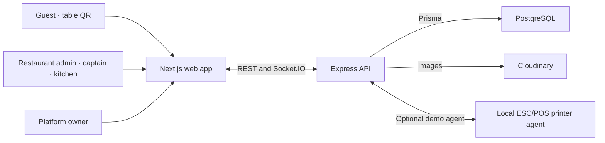

# ServeSync architecture

The web app exposes public marketing and registration, a platform review portal, restaurant administration, captain and kitchen dashboards, and guest table pages. `/apply` submits an application. An authorized platform owner approves or rejects it from `/platform`. Approval creates the restaurant, staff and QR tables in one transaction with the application state change. Restaurant admin, captain and kitchen interfaces have separate routes and server-enforced role checks.

Restaurant records have a tenant identifier. Staff authorization loads the account from PostgreSQL and uses its restaurant ID. The platform owner is an admin account with no restaurant membership and can select an explicit tenant for authorized support operations. Customer routes resolve the tenant from the restaurant slug. Legacy table URLs resolve to the Sree Nookambika Family Dhaba demo. New tenants receive per-table QR tokens whose hashes are stored in the database.

After a valid QR scan, the API starts or resumes a dining session and issues a signed capability. A table row lock serializes session creation for the same table. The client submits orders with that capability and an idempotency key. The server prices items from its own menu, saves order and line items together, and emits a tenant-scoped update to staff. The kitchen and captain views reload current state from the API as needed. Guests subscribe to their session's room for progress.

A bill request transitions the session to `BILL_REQUESTED` once. Staff close the session after payment, which updates the guest view and allows a subsequent scan to start a new session. Closed sessions and orders remain available to authorized staff. Tables and menu items referenced by historical records can be disabled or marked unavailable.

Printing supports browser/PDF flows and optional adapters for Bluetooth, serial and network printers. The current server-side gateway serves the demo tenant through a single agent connection and queues jobs in process while the agent reconnects. The SQL print-job history is tenant-scoped. Provider configuration and physical compatibility require separate verification.
